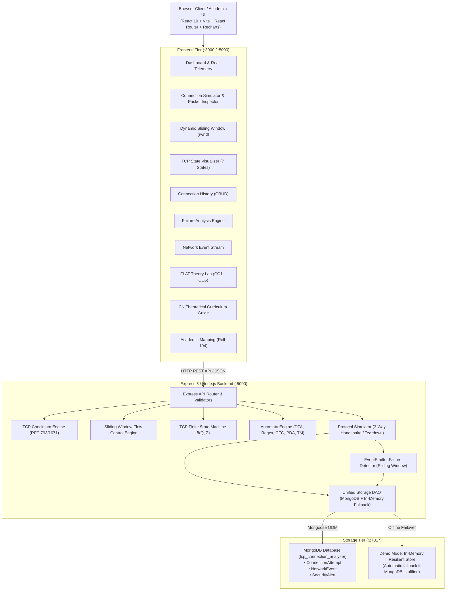

# TCP Connection Failure Analysis System

**Roll Number:** 104  
**Class:** 25IT5A & B (Odd Semester)  
**Academic Year:** 2026 – 2027  
**Department:** Information Technology, Velalar College of Engineering and Technology, Erode – 638 012  
**Problem Statement #43:** *TCP Connection Failure Analysis System*  

---

## Academic Assessment & Course Outcomes (CO) Mapping

This project serves as the unified project-based assessment integrating three core computing disciplines:

| Subject Code | Subject Name | Mapped Course Outcomes (CO) | Implemented Feature in Project |
| :--- | :--- | :--- | :--- |
| **22ITT51** | **Full Stack Web Development (FSWD)** | **CO1:** Web Page Design & Validation<br>**CO2:** Full-Stack Architecture<br>**CO3:** Components, State & Routing<br>**CO4:** Event-Driven Failure Detection<br>**CO5:** MongoDB & Mongoose CRUD | • Hostname & Port input validation (RFC 1123, 1-65535)<br>• React 19 SPA ↔ Express 5 REST API ↔ MongoDB<br>• Modular UI, Recharts analytics, dynamic DB indicator<br>• Node.js `EventEmitter` sliding-window alert engine<br>• Collections: `ConnectionAttempt`, `NetworkEvent`, `SecurityAlert` (with transparent In-Memory Demo Storage fallback) |
| **22ITT52** | **Computer Networks (CN)** | TCP Handshake, Teardown,<br>Checksum Verification,<br>Flow Control & Failure Modes | • 3-Way Handshake (`SYN` → `SYN-ACK` → `ACK`)<br>• Graceful 4-Way Teardown (`FIN` → `ACK` → `FIN` → `ACK`)<br>• **RFC 793 / 1071 16-bit 1's Complement Checksum** with IPv4 pseudo-header & odd-length byte padding<br>• **Packet Corruption Simulation** & Bit-Flip Checksum Mismatch Detection<br>• **Dynamic Sliding Window Flow Control (`rwnd`)**, Zero Window state, Zero Window Probes (ZWP), and Window Updates<br>• **12-Field TCP Packet Inspector** modal<br>• Root-cause analysis: `ECONNREFUSED` (TCP RST) vs `ETIMEDOUT` (Packet drop & RTO backoff) |
| **22ITT53** | **Formal Languages and Automata Theory (FLAT)** | **CO1:** Finite Automata (DFA)<br>**CO2:** Regular Expressions<br>**CO3:** Context-Free Grammars<br>**CO4:** Pushdown Automata<br>**CO5:** Turing Machines & Decidability | • Formal 5-tuple $M=(Q,\Sigma,\delta,q_0,F)$ with 7 states: `Closed`, `Connecting`, `Established`, `Waiting`, `Terminated`, `Failed`, `Timeout`<br>• Regular expressions & RFC 793 semantic validation for IPv4, Port, Hostname, TCP Flags (`[SYN]`, `[SYN, ACK]`, `[PSH, ACK]`, `[FIN, ACK]`, `[RST, ACK]`), and Packet Records<br>• Interactive Context-Free Grammar ($G$) sequence parser with derivation steps & acceptance verification<br>• 7-tuple Pushdown Automaton ($M_{PDA}$) with LIFO frame push/pop trace visualizer and $Z_0$ acceptance<br>• **Interactive Turing Machine Tape Simulator ($M_{TM}$)** with step-by-step head movements detecting missing Handshake ACK (`q_missing_ack`) and TIMEOUT markers (`q_timeout_detected`) |

---

## System Architecture



---

## Key Features & Module Implementations

### 1. Computer Networks (22ITT52)
- **3-Way Handshake & 4-Way Teardown:** Full synchronization lifecycle (`SYN` $\to$ `SYN-ACK` $\to$ `ACK` $\to$ `ESTABLISHED`), application data transfer (`PSH-ACK`), and half-closed graceful teardown (`FIN` $\to$ `ACK` $\to$ `FIN` $\to$ `ACK`).
- **RFC 793 / 1071 16-Bit One's Complement Checksum:** Genuine computation over the 12-byte IPv4 Pseudo-Header (Source IP, Destination IP, Protocol 6, Segment Length), 20-byte TCP Header, and payload. Automatically pads odd-length payloads with a trailing `0x00` byte, sums 16-bit words, folds 32-bit carry bits, and takes the one's complement.
- **Packet Corruption Simulation:** Inject simulated bit-flips or modified bytes into transmitted segments. The receiver recalculates the checksum, detects the mismatch, rejects the corrupted packet, and logs a `CHECKSUM_MISMATCH` audit event.
- **12-Field Packet Inspector Modal:** Inspect Source IP/Port, Destination IP/Port, Sequence Number (SEQ), Acknowledgment Number (ACK), TCP Control Flags, Window Size, Checksum Hex, Checksum Status (`VALID` vs `CORRUPTED`), Payload Size, Timestamp, Direction, and algorithmic breakdown.
- **Dynamic Sliding Window Flow Control:** Interactive receiver buffer (4096 bytes) tracking `rwnd`, sequence progress, and buffer draining. Demonstrates Zero Window condition (`rwnd = 0`), Zero Window Probes (ZWP), and Window Update notifications.
- **Theoretical Curriculum Guide:** In-depth educational panels covering OSI vs TCP/IP layering, 3-way handshake mechanics, checksum mathematics, sliding window flow control, TCP vs UDP tradeoffs, and failure modes (`ECONNREFUSED` vs `ETIMEDOUT`).

### 2. Formal Languages and Automata Theory (22ITT53)
- **CO1 – Finite State Machine (DFA):** Implements $M = (Q, \Sigma, \delta, q_0, F)$ with 7 states: `Closed`, `Connecting`, `Established`, `Waiting`, `Terminated`, `Failed`, `Timeout`. Visual glowing state graph and transition table $\delta(State, Symbol)$. Rejects invalid transitions with formal explanations.
- **CO2 – Regular Expressions & Semantic Validation:** Formal regular expressions validating IPv4 addresses, port numbers (1–65535), RFC 1123 hostnames, TCP control flag syntax (`SYN`, `ACK`, `FIN`, `RST`, `PSH`), flag combinations, and raw packet records. Incorporates RFC 793 semantic validation (e.g. rejecting contradictory `[SYN, FIN]` combinations).
- **CO3 – Context-Free Grammar (CFG):** Formal 4-tuple $G = (V, \Sigma, R, S)$. Features an interactive event sequence parser that tokenizes and parses user-entered sequences (e.g., `CONNECT SYN SYN_ACK ACK DATA FIN ACK`), producing complete leftmost derivations and acceptance/rejection diagnostics.
- **CO4 – Pushdown Automata (PDA):** 7-tuple $M_{PDA} = (Q, \Sigma, \Gamma, \delta, q_0, Z_0, F)$ with an interactive LIFO stack trace visualizer. Demonstrates pushing connection frame tokens (`SYN_FRAME`) onto the stack and popping them on matching acknowledgments (`ACK_TOKEN`), verifying acceptance upon empty stack or initial marker $Z_0$.
- **CO5 – Turing Machine (TM) Tape Simulator:** Interactive Turing Machine $M_{TM} = (Q, \Sigma, \Gamma, \delta, q_0, B, F)$ simulating tape head operations across TCP event symbols. Features step-by-step playback, customizable tape inputs, and specialized sub-routines detecting missing Handshake ACKs (`q_missing_ack`) and TIMEOUT drop markers (`q_timeout_detected`).

### 3. Full Stack Web Development (22ITT51)
- **Modern Responsive React 19 Frontend:** Cyber Dark academic interface built with Vite, React Router 7, and Lucide icons.
- **Real-Time Recharts Telemetry Dashboard:** Live status distribution donut chart, RTT latency trend line chart, failure mode breakdown bar chart, and active security alert indicators.
- **Dynamic Database Status Indicator:** Accurately distinguishes live MongoDB connectivity (`MongoDB: Connected (tcp_connection_analyzer)`) from offline fallback (`Demo Mode – In-Memory Storage`).
- **Complete MongoDB CRUD Operations:** View paginated connection records, filter by status, search by hostname, inspect handshake parameters, create manual records, edit notes/status, and delete records.
- **Event-Driven Failure Detector (Node.js EventEmitter):** Monitors connection failure velocity in a sliding time window (3 failures within 60s) to detect port-scanning, server downtime, or firewall blackholes, generating `SecurityAlert` records.

---

## Directory Structure

```text
tcp-connection-failure-analysis-system/
├── backend/
│   ├── config/
│   │   ├── db.js                 # Dynamic MongoDB connection & status tracker
│   │   └── storage.js            # Unified DAO (MongoDB + In-Memory Fallback)
│   ├── controllers/
│   │   ├── alertController.js    # Security alert management
│   │   ├── connectionController.js # Complete CRUD operations
│   │   ├── dashboardController.js  # Telemetry aggregation & DB status
│   │   ├── eventController.js    # Network audit stream
│   │   ├── flatController.js     # Automata, CFG parser & TM simulator
│   │   ├── fsmController.js      # FSM state & transition endpoints
│   │   └── simulatorController.js# Protocol simulation, checksum & sliding window
│   ├── engine/
│   │   ├── failureDetector.js    # Node.js EventEmitter failure detection (CO4)
│   │   ├── slidingWindow.js      # TCP sliding window flow control engine (rwnd)
│   │   ├── tcpChecksum.js        # RFC 793/1071 16-bit 1's complement checksum engine
│   │   ├── tcpFSM.js             # Formal 7-state finite automaton logic
│   │   └── tcpSimulator.js       # Handshake, corruption & retransmission engine
│   ├── flat/
│   │   └── flatEngine.js         # DFA, Regex, CFG parser, PDA & TM algorithms
│   ├── middleware/
│   │   ├── errorHandler.js       # Centralized JSON error handler
│   │   └── validator.js          # Hostname & port validation middleware
│   ├── models/
│   │   ├── ConnectionAttempt.js  # Mongoose schema
│   │   ├── NetworkEvent.js       # Mongoose schema
│   │   ├── SecurityAlert.js      # Mongoose schema
│   │   └── storage.js            # DAO with auto-seeding
│   ├── routes/                   # Express REST API routes
│   ├── tests/
│   │   ├── flat.test.js          # 12 FLAT unit tests (CO1 - CO5)
│   │   ├── cn.test.js            # 15 Computer Networks tests (Checksum, Flow Control)
│   │   └── integration.test.js   # 20 Full Stack Integration scenarios (Task 4)
│   ├── .env                      # Local environment configuration
│   ├── package.json              # Backend dependencies & test scripts
│   └── server.js                 # Express server & static asset host
├── frontend/
│   ├── src/
│   │   ├── api/
│   │   │   └── client.js         # REST API client with all endpoints
│   │   ├── components/
│   │   │   ├── EmptyState.jsx    # Empty state component
│   │   │   ├── Header.jsx        # Top header with dynamic DB status badge
│   │   │   ├── LoadingSpinner.jsx# Animated loader
│   │   │   ├── Sidebar.jsx       # Academic navigation sidebar
│   │   │   └── StatusBadge.jsx   # Status indicator badges
│   │   ├── pages/
│   │   │   ├── AboutProject.jsx  # Academic details & CO mapping
│   │   │   ├── ConnectionHistory.jsx # MongoDB CRUD management
│   │   │   ├── ConnectionSimulator.jsx # Handshake, Checksum, Flow Control, Inspector
│   │   │   ├── Dashboard.jsx     # Recharts metrics dashboard
│   │   │   ├── FailureAnalysis.jsx # EventEmitter failure alerts
│   │   │   ├── FLATTheoryLab.jsx # 5 Automata course outcomes testbenches
│   │   │   ├── NetworkEvents.jsx # Packet audit event stream
│   │   │   └── TCPStateVisualizer.jsx # Interactive 7-state FSM
│   │   ├── App.jsx               # React Router routes
│   │   ├── index.css             # Cyber Dark styling
│   │   └── main.jsx              # React DOM entry point
│   ├── index.html                # HTML entry template
│   ├── package.json              # Frontend dependencies & scripts
│   └── vite.config.js            # Vite build & /api proxy configuration
├── package.json                  # Root runner script
└── README.md                     # Comprehensive project documentation
```

---

## Installation & Setup

### Prerequisites
- **Node.js**: v18.0.0 or higher (Tested and verified on Node.js v24.21.0)
- **npm**: v9.0.0 or higher
- **MongoDB** *(Optional)*: Local MongoDB instance or MongoDB Atlas. When MongoDB is unavailable or offline, the system automatically runs in **Demo Mode – In-Memory Storage** with zero crashes.

### Step 1: Navigate to the Project Directory
```bash
cd tcp-connection-failure-analysis-system
```

### Step 2: Install Dependencies
```bash
# Install backend dependencies
cd backend
npm install

# Install frontend dependencies
cd ../frontend
npm install
```

### Step 3: Configure Environment Variables
Inside `backend/`, verify or create `.env`:
```env
PORT=5000
MONGODB_URI=mongodb://127.0.0.1:27017/tcp_connection_analyzer
NODE_ENV=development
CONSECUTIVE_FAILURE_THRESHOLD=3
FAILURE_WINDOW_MS=60000
```

---

## Running the Application

### Option A: Unified Production Build (Recommended)
You can run the entire application (both frontend React SPA and backend Express API) from the unified server on port 5000:
```bash
# 1. Build frontend production assets
cd frontend
npm run build

# 2. Start the unified server
cd ../backend
npm start
```
- **Unified Application URL:** `http://localhost:5000`
- **Backend API Health:** `http://localhost:5000/api/health`

### Option B: Separate Development Servers
```bash
# Terminal 1: Backend API (Port 5000)
cd backend
npm run dev

# Terminal 2: Frontend Vite Dev Server (Port 3000)
cd frontend
npm run dev
```
- **Frontend URL:** `http://localhost:3000`
- **Backend URL:** `http://localhost:5000`

---

## Running Automated Tests

The application features 3 dedicated test suites executing 47 comprehensive automated tests across all three subjects:

```bash
# Run all 47 automated tests from backend
cd backend
npm test
```

### Breakdown of Test Suites:
1. **FLAT Theory Lab Tests (`tests/flat.test.js`):** **12 / 12 Passed**
   - Valid & Invalid IPv4 addresses, Port boundaries, TCP Flag syntax and combinations, CFG sequence derivation, PDA stack operations, and Turing Machine missing ACK & timeout detection.
2. **Computer Networks Tests (`tests/cn.test.js`):** **15 / 15 Passed**
   - 16-bit 1's complement checksum calculation, odd-length payload padding, packet corruption injection, checksum mismatch verification, sliding window byte transmission within `rwnd`, Zero Window condition, Zero Window Probes (ZWP), and Window Updates.
3. **Full Stack Integration Tests (`tests/integration.test.js`):** **20 / 20 Passed**
   - Verifies end-to-end integration across FSWD, CN, and FLAT modules including storage fallback, health telemetry, pagination, and API contracts.

### Frontend Quality Checks:
```bash
# Run frontend linter
cd frontend
npm run lint

# Run production build
npm run build
```
- **Linter Result:** 0 warnings, 0 errors (verified with `oxlint`).
- **Build Result:** 100% clean production build compiled to `frontend/dist/`.

---

## Database Configuration & Storage Modes

The system features an enterprise-grade dual-mode data persistence architecture:

1. **MongoDB Mode (Persistent):**
   - Connects to local MongoDB (`mongodb://127.0.0.1:27017/tcp_connection_analyzer`) or MongoDB Atlas.
   - When connected, the UI header dynamically displays:  
     🟢 `MongoDB: Connected (tcp_connection_analyzer)`
   - All connection attempts, audit logs, and security alerts are persisted in Mongoose collections: `ConnectionAttempt`, `NetworkEvent`, and `SecurityAlert`.

2. **In-Memory Demo Storage Mode (Resilient Fallback):**
   - If MongoDB is offline, uninstalled, or network-restricted, the system gracefully engages its in-memory storage engine.
   - The UI header and dashboard dynamically display:  
     🟡 `Demo Mode – In-Memory Storage`  
     *“MongoDB service is offline. Running with resilient in-memory store (session data resets on restart).”*
   - Pre-seeded with realistic connection records, audit events, and security alerts. All CRUD operations, filtering, sorting, pagination, and failure detections remain 100% functional without throwing unhandled exceptions.

---

## Project Credentials & Attribution

- **Project Title:** TCP Connection Failure Analysis System
- **Problem Statement Number:** 43
- **Student Candidate:** Roll Number 104
- **Degree & Class:** B.Tech Information Technology, Class 25IT5A & B
- **Institution:** Velalar College of Engineering and Technology, Thindal, Erode – 638 012
- **Academic Year:** 2026 – 2027
- **Course Integration:**
  - `22ITT51` – Full Stack Web Development
  - `22ITT52` – Computer Networks
  - `22ITT53` – Formal Languages and Automata Theory
